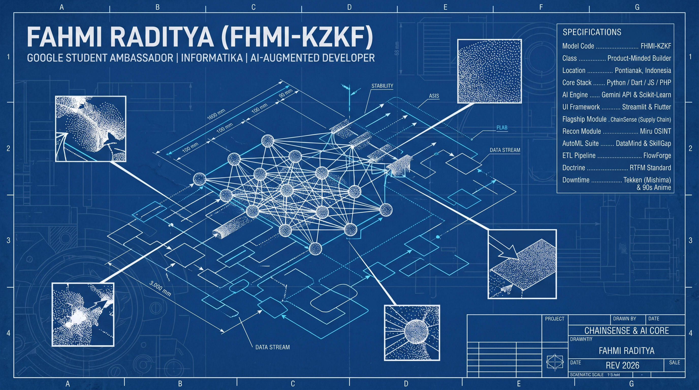

<div align="center">

<!-- =========================================================================================
     [OPSI 1: BANNER GAMBAR BLUEPRINT 3D KUSTOM]
     Simpan gambar banner blueprint di atas ke repo `fhmi-kzkf/fhmi-kzkf` sebagai `blueprint-banner.jpg`,
     lalu hapus tanda komentar pada baris di bawah ini:
     
========================================================================================== -->

<!-- [OPSI 2: HEADER BLUEPRINT OTOMATIS (LANGSUNG JALAN TANPA UPLOAD FILE)] -->


<a href="https://git.io/typing-svg">
  
</a>

<br/>

<a href="https://linkedin.com/in/fahmi-raditya-a590b62a6/">
  
</a>
<a href="https://github.com/fhmi-kzkf/ChainSense">
  
</a>


</div>

<br/>

## `01 // TECHNICAL SPECIFICATIONS & SYSTEM OVERVIEW [GRID A1-D2]`

```yaml
┌──────────────────────────────────────────────────────────────────────────────────────────────────┐
│  CAD SCHEMATIC SHEET : FHMI-KZKF (REV 2026)                     UNITS : COMMITS / NODES / PIPES  │
│  DRAWN BY            : FAHMI RADITYA                            GRID  : A1 - G4 ORTHOGRAPHIC     │
├──────────────────────────────────────────────┬───────────────────────────────────────────────────┤
│  SYSTEM OVERVIEW                             │  SPECIFICATIONS                                   │
│                                              │                                                   │
│  Based in Pontianak, Indonesia, I am an      │  Model Code ........... FHMI-KZKF                 │
│  Informatics student with a deep focus on    │  Class ................ Product-Minded Builder    │
│  Supply Chain Analytics, Applied AI,         │  Designation .......... Google Student Ambassador │
│  Data Science, and Machine Learning.         │  Location ............. Pontianak, Indonesia      │
│                                              │  Development Mode ..... AI-Augmented (Vibe Code)  │
│  Unlike the traditional coder, I operate as  │  Flagship Module ...... ChainSense (Supply Chain) │
│  a "Product-Minded Builder"—leveraging LLMs  │  R&D Pipeline ......... MLOps, Graph Theory, GCP  │
│  to accelerate execution so I can focus on   │  Doctrine ............. RTFM Standard             │
│  System Architecture and Business Value.     │  Downtime ............. Tekken (Mishima) & 90s    │
└──────────────────────────────────────────────┴───────────────────────────────────────────────────┘
```

<div align="center">
  
  
  <br/>
  <sub><code>[FIG 1.1 : LOCALHOST EXECUTION]</code> &nbsp;&nbsp;&nbsp;&nbsp;&nbsp; <code>|◄────── TOLERANCE DELTA ──────►|</code> &nbsp;&nbsp;&nbsp;&nbsp;&nbsp; <code>[FIG 1.2 : PRODUCTION CRASH TELEMETRY]</code></sub>
  <br/>
  <sub><i>"Me when the code works on localhost but crashes in production."</i></sub>
</div>

<br/>

## `02 // POWERTRAIN & ARSENAL MATRIX [GRID B1-B4]`

| `SUBSYSTEM CODE` | `ENGINEERING LAYER` | `INSTALLED COMPONENTS & MODULES` |
| :--- | :--- | :--- |
| **`[SYS-01]`** | **Core Languages** | [https://img.shields.io/badge/PYTHON-0B3B75?style=flat-square&logo=python&logoColor=white&labelColor=061F40] [https://img.shields.io/badge/PHP-0B3B75?style=flat-square&logo=php&logoColor=white&labelColor=061F40] [https://img.shields.io/badge/JAVASCRIPT-0B3B75?style=flat-square&logo=javascript&logoColor=F7DF1E&labelColor=061F40] [https://img.shields.io/badge/DART-0B3B75?style=flat-square&logo=dart&logoColor=white&labelColor=061F40] |
| **`[SYS-02]`** | **Data & Applied AI** | [https://img.shields.io/badge/PANDAS-104382?style=flat-square&logo=pandas&logoColor=white&labelColor=061F40] [https://img.shields.io/badge/NUMPY-104382?style=flat-square&logo=numpy&logoColor=white&labelColor=061F40] [https://img.shields.io/badge/SCIKIT--LEARN-104382?style=flat-square&logo=scikit-learn&logoColor=F7931E&labelColor=061F40] [https://img.shields.io/badge/GOOGLE_GEMINI_API-1E56A0?style=flat-square&logo=google&logoColor=white&labelColor=061F40] |
| **`[SYS-03]`** | **Web & Mobile UI** | [https://img.shields.io/badge/STREAMLIT-0B3B75?style=flat-square&logo=streamlit&logoColor=FF4B4B&labelColor=061F40] [https://img.shields.io/badge/FLUTTER-0B3B75?style=flat-square&logo=flutter&logoColor=white&labelColor=061F40] [https://img.shields.io/badge/HTML5-0B3B75?style=flat-square&logo=html5&logoColor=E34F26&labelColor=061F40] |
| **`[SYS-04]`** | **Ops, DB & Cockpit** | [https://img.shields.io/badge/GIT-104382?style=flat-square&logo=git&logoColor=F05032&labelColor=061F40] [https://img.shields.io/badge/POSTGRESQL_%2F_SQL-104382?style=flat-square&logo=postgresql&logoColor=white&labelColor=061F40] [https://img.shields.io/badge/TRAE_%2F_CURSOR_IDE-1E56A0?style=flat-square&logo=visual-studio-code&logoColor=white&labelColor=061F40] |

<br/>

## `03 // ORTHOGRAPHIC MODULE SCHEMATICS (FEATURED PROJECTS)`

<table>
  <tr>
    <td width="50%" valign="top">
      <h4><code>[MOD-01 // FLAGSHIP]</code> 🔗 <a href="https://github.com/fhmi-kzkf/ChainSense">ChainSense</a></h4>
      <blockquote><i>Supply Chain Risk Monitoring &amp; Intelligence System</i></blockquote>
      <pre lang="text">
CLASS    : Logistics Anomaly & Delay Predictor
ENGINE   : Synthetic Data + Graph Theory
STACK    : Python | Streamlit | NetworkX | Gemini XAI
IMPACT   : Actionable operational risk mitigation</pre>
    </td>
    <td width="50%" valign="top">
      <h4><code>[MOD-02 // RECON]</code> 🕵️ <a href="https://github.com/fhmi-kzkf/Miru-OSINT">Miru OSINT</a></h4>
      <blockquote><i>Advanced Open Source Intelligence Dashboard</i></blockquote>
      <pre lang="text">
CLASS    : Ethical Reconnaissance ("Miru" = To View)
ENGINE   : Deep-Dive Digital Footprint Analyzer
STACK    : Python | Streamlit | OSINT APIs
SECTOR   : Cyber Security & Digital Investigation</pre>
    </td>
  </tr>
  <tr>
    <td width="50%" valign="top">
      <h4><code>[MOD-03 // AUTOML]</code> 🧠 <a href="https://github.com/fhmi-kzkf/DataMind">DataMind</a></h4>
      <blockquote><i>No-Code ML &amp; Exploratory Data Analysis Platform</i></blockquote>
      <pre lang="text">
CLASS    : End-to-End Automated Data Science Suite
ENGINE   : CSV Ingestion -> EDA -> PCA -> AutoML
STACK    : Python | Streamlit | Pandas Profiling
SECTOR   : Democratizing Data Science</pre>
    </td>
    <td width="50%" valign="top">
      <h4><code>[MOD-04 // EDTECH]</code> 🎓 <a href="https://github.com/fhmi-kzkf/SkillGap">SkillGap Analysis</a></h4>
      <blockquote><i>Career Pathway Recommender System</i></blockquote>
      <pre lang="text">
CLASS    : Dynamic Competency & Course Matcher
ENGINE   : Hybrid ML & NLP Recommendation Graph
STACK    : Python | Scikit-learn | NLP
SECTOR   : EdTech & Career Architecture</pre>
    </td>
  </tr>
  <tr>
    <td colspan="2" valign="top">
      <h4><code>[MOD-05 // DATA PIPELINE]</code> ⚡ <a href="https://github.com/fhmi-kzkf/FlowForge">FlowForge</a></h4>
      <blockquote><i>Interactive Web-Based ETL Platform</i></blockquote>
      <pre lang="text">
|◄──── EXTRACTION (RAW INGEST) ────►|◄──── TRANSFORMATION (PANDAS/CLEAN) ────►|◄──── LOADING (WAREHOUSE READY) ────►|
STACK : Python • Streamlit • Pandas • Automated ETL Workflows     |     FOCUS : Data Engineering & Pipeline Automation</pre>
    </td>
  </tr>
</table>

<br/>

## `04 // DIAGNOSTICS & TELEMETRY [GRID F1-G4]`

<div align="center">
  
  
</div>

<br/>

```text
┌───────────────────────────────────────────────────────────┬──────────────────────────────────────┐
│  PROJECT  : CHAINSENSE & AI CORE                          │  "We are all connected...            │
│  DRAWN BY : FAHMI RADITYA (FHMI-KZKF)                     │   to the net." — Lain Iwakura        │
│  SCALE    : 1:1  |  DATE : REV 2026  |  LOC : PONTIANAK   │  STATUS : [●] ALL SYSTEMS NOMINAL    │
└───────────────────────────────────────────────────────────┴──────────────────────────────────────┘
```
